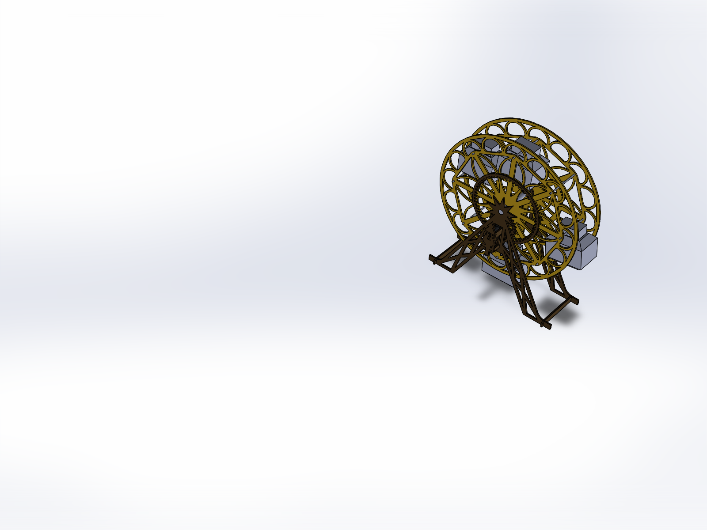
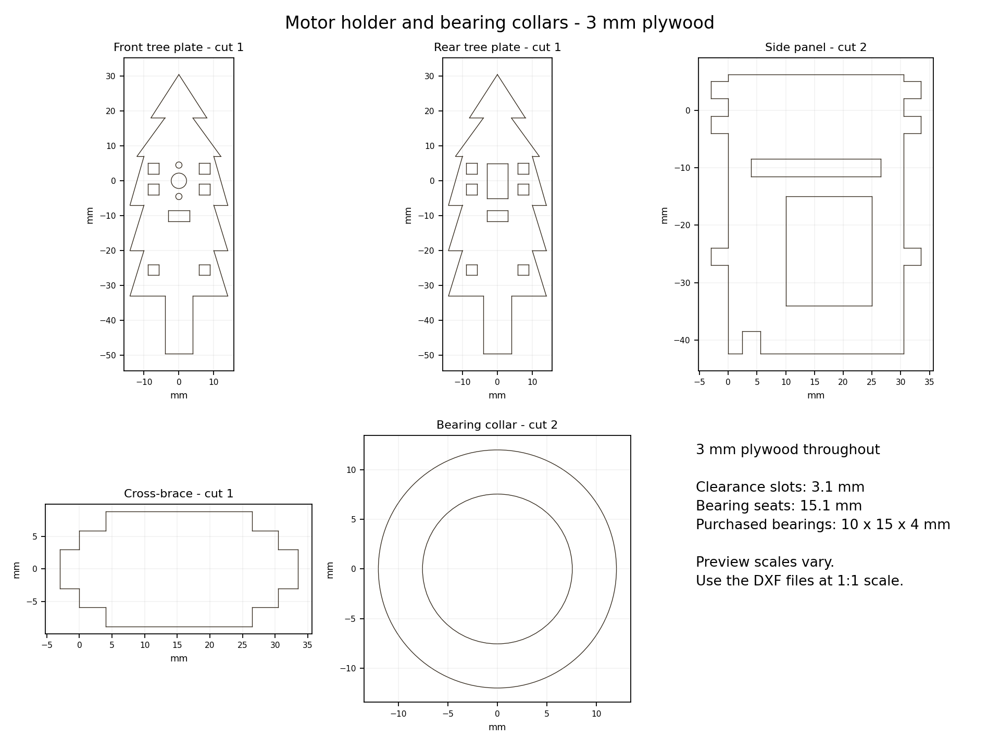

# miniriesenrad

Maintained fork of [kn0del/miniriesenrad](https://github.com/kn0del/miniriesenrad), a motorized Ferris wheel advent calendar. Original project and design credit: **kn0del**. The original history and [license](LICENSE) are retained.

**Use 3.0 mm plywood for every custom sheet part**, including wheels, legs, braces, gears, the motor holder, and bearing-support collars. The earlier 3.5 mm revision is superseded.

- Current editable assembly: [solid_3mm/Assem1.SLDASM](solid_3mm/Assem1.SLDASM), SolidWorks 2025.
- Motion inspection assembly: [solid_3mm/Motion-3mm.SLDASM](solid_3mm/Motion-3mm.SLDASM); [instructions and confirmed interactive check](docs/motion-assembly.md).
- Portable assembly: [exports/miniriesenrad-3mm.step](exports/miniriesenrad-3mm.step).
- Laser outlines: [lasercutter/](lasercutter/), 1:1 in millimetres; use the [current cut list](docs/3mm-revision.md).
- [Material standard](design/materials.json) and [motor/mount dimensions](motor/n20-mount-design.json).

The wheels remain **303.64 mm diameter**, with a **72 mm clear gap**. Use eight **3 × 83 mm bamboo skewers**, one **10 × 99 mm main axle dowel**, and **two purchased 10 × 15 × 4 mm bearings**. The 15.1 mm bearing seats have 3 mm plywood reinforcing collars.

The N20 motor sits inside a five-piece plywood tree holder on the drive leg. Its 3 mm D-shaped shaft engages the original pinion profile. All custom holder and gear parts are laser-cut plywood; two M1.6 × 5 screws mount the motor.

The root `solid/` and `3d_print/` folders contain reference/superseded assets. The unused `stift.DXF` is an upstream flat-pin alternative. They are not the current 3 mm fabrication set.

Development happens on `develop` in [adhocwarlock/miniriesenrad](https://github.com/adhocwarlock/miniriesenrad/tree/develop).

Start with the [maintainer handover](docs/handover.md) for completed work, verification, ownership, and remaining tasks. Claude's [electronics design](docs/electronics.md) and the shared [project plan](docs/project-plan.md) cover the planned controller, lights, audio, and calendar behaviour. New CircuitPython device firmware has not been added yet; `miniriesenrad/` contains the original upstream firmware.

PC music tools:

- Install `numpy` for `tools/chiptune_preview.py`, which renders three demo arrangements to a chosen output folder.
- Install `mido` and `numpy` for `tools/midi2chip.py`, which converts a MIDI input into a chiptune WAV. See each script's usage header. Keep private song files and generated audio outside Git.

